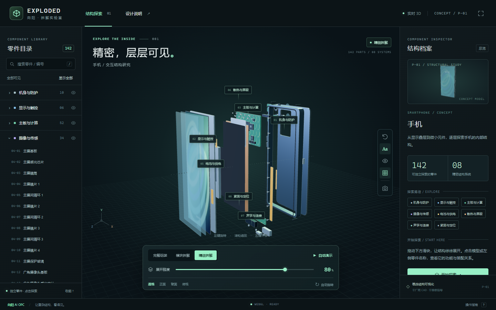
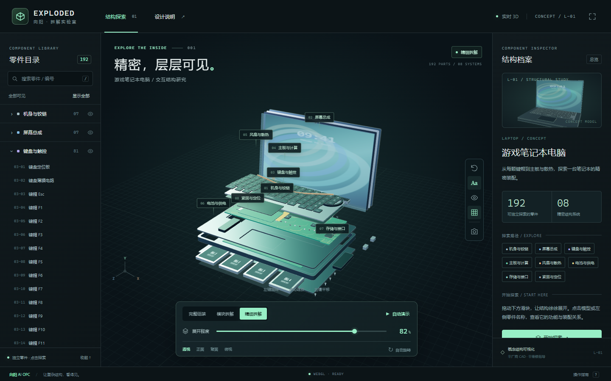
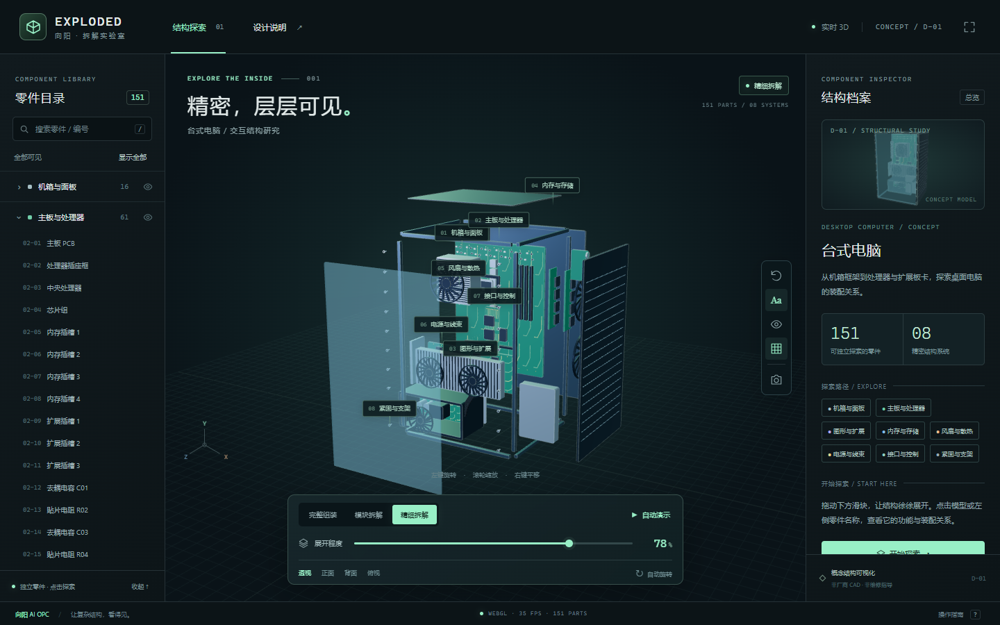
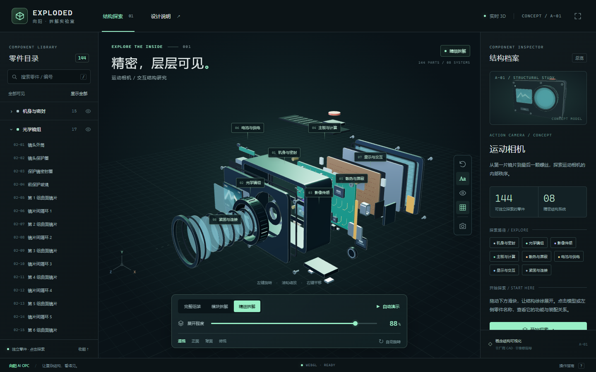

# 3C 数码拆解实验室

**输入一个数码产品，让 AI 制作可旋转、可分层展开、可查看每个零件的 3D 拆解网页。**

由 **向阳 AI OPC** 制作，使用 HTML、CSS、JavaScript 和 Three.js。默认面向电脑端，采用深色工业风、薄荷绿点缀和三栏结构工作台。

[下载 Skill 安装包](https://github.com/bestwangjing/wj-3c-exploded-explorer/releases/latest/download/wj-3c-exploded-explorer.zip) · [使用方法](#快速开始) · [手动运行](#不使用-ai也能运行内置模型) · [MIT 许可证](LICENSE)

> 这是包含指令、脚本和页面模板的 Agent Skill。四类内置产品可以直接生成；其他产品需要 AI 按结构编写专属模型。模型是概念结构示意，不是厂商 CAD、精确拆机数据或维修图纸。

## 效果预览

以下图片来自实际运行的页面。

| 手机 · 142 个独立零件 | 笔记本 · 192 个独立零件 |
|---|---|
|  |  |
| 台式机 · 151 个独立零件 | 运动相机 · 144 个独立零件 |
|  |  |

## 可以做什么

- 鼠标拖动旋转、滚轮缩放、右键平移。
- 用连续滑块控制完整组装、模块拆解和精细拆解，平滑复原。
- 点击模型或零件目录，查看名称、功能和结构说明。
- 搜索零件、隐藏系统、聚焦组件、单独查看并恢复整机。
- 切换外壳透视、四种视角、标签、网格、自动旋转和自动拆装。
- 导出当前三维视图 PNG，切换全屏。

Three.js 和 OrbitControls 已随包提供，生成后的本地页面不依赖外部 CDN。无需数据库、后端服务或本项目专属 API Key；使用 AI 工具本身仍需满足该工具的账户与环境要求。

## 快速开始

### 1. 准备环境

使用能够读取本地文件、生成代码并执行命令的 AI 编程工具。已验证工作流使用 Codex；其他工具可以按下方方法读取 `SKILL.md`，但未逐一验证其原生 Skill 安装机制。普通纯聊天窗口不能直接替你执行本地脚本。

本地生成与运行需要：

| 工具 | 用途 |
|---|---|
| Python 3（建议 3.10 或更高） | 运行生成脚本，仅使用标准库 |
| Node.js（18 或更高） | 运行随包提供的本地 HTTP 服务 |
| 支持 WebGL 的桌面浏览器 | 查看和操作三维页面，已测试 Edge / Chromium |
| Git（可选） | 克隆与更新仓库，也可以下载 ZIP |

### 2. 安装到 Codex

**最省事：**把以下文字发给 Codex：

```text
使用 $skill-installer，从这个仓库安装 Skill：
https://github.com/bestwangjing/wj-3c-exploded-explorer
Skill 位于仓库根目录，名称是 wj-3c-exploded-explorer。
```

**也可以手动安装。**将仓库完整放入用户的 Skills 目录，最终目录应是：

```text
~/.agents/skills/wj-3c-exploded-explorer/SKILL.md
```

Windows PowerShell：

```powershell
$skillParent = Join-Path $env:USERPROFILE '.agents\skills'
New-Item -ItemType Directory -Force -Path $skillParent | Out-Null
git clone https://github.com/bestwangjing/wj-3c-exploded-explorer.git (Join-Path $skillParent 'wj-3c-exploded-explorer')
```

macOS / Linux：

```bash
mkdir -p "$HOME/.agents/skills"
git clone https://github.com/bestwangjing/wj-3c-exploded-explorer.git "$HOME/.agents/skills/wj-3c-exploded-explorer"
```

不用 Git 时，下载顶部安装包，解压后把整个 `wj-3c-exploded-explorer` 文件夹放入上述目录。不要只复制 `SKILL.md`，脚本和 `assets` 都需要保留。

若已有环境使用 `~/.codex/skills`，沿用已有路径即可，避免在两个位置重复安装同名 Skill。当前官方文档列出的用户目录为 `~/.agents/skills`；新安装未出现时可重启 Codex，参见 [OpenAI Skills 文档](https://learn.chatgpt.com/docs/build-skills)。

### 3. 输入你想拆解的产品

```text
使用 $wj-3c-exploded-explorer，把一台手机做成精细的 3D 爆炸拆解网页。
```

也可以这样说：

```text
使用 $wj-3c-exploded-explorer，制作一台游戏笔记本的拆解页面，
重点细化键帽、风扇、热管、内存、SSD 和主板元件。
```

```text
使用 $wj-3c-exploded-explorer，制作台式电脑的交互拆解页面，
包含机箱、主板、显卡、内存、电源、散热和连接线。
```

```text
使用 $wj-3c-exploded-explorer，把无线耳机和充电盒做成拆解网页。
请根据它们的结构生成专属模型，不使用相机模型代替。
仅本地运行，完成后检查主要交互并给我源码。
```

可附参考图、视频、型号和输出目录。指定型号时，未提供可靠内部结构资料的部分仍按概念示意处理；不会自动获得真实 CAD。

### 4. 查看结果

AI 会生成独立项目、启动预览并检查交互。若仅得到本地文件，进入生成目录运行：

```bash
node serve.mjs
```

打开控制台打印的地址，默认是 `http://127.0.0.1:4173`。Windows 也可双击项目里的 `启动页面.cmd`，保持窗口打开。

**不要直接双击 `dist/index.html`。**页面使用 ES 模块，需要通过 HTTP 服务加载。关闭服务后，本地地址也会停止访问。是否在线发布取决于 AI 工具能力和你的要求；生成页面不会自动得到公开网址。

## 在其他 AI 编程工具中使用

将仓库下载到本地并作为工作区打开，再输入：

```text
请完整阅读此仓库的 SKILL.md，并按它的流程完成任务：
把一台手机制作成精细的 3D 爆炸拆解交互网页。
使用仓库内的脚本和模板，输出到仓库外的新目录，
实际检查交互后交付源码和启动说明。
```

如果工具提供自己的 Skill 导入入口，可导入完整文件夹。各工具的安装目录和调用语法可能不同，本项目不承诺所有工具都能自动识别 `$技能名`。

## 不使用 AI，也能运行内置模型

在仓库根目录打开终端：

```bash
python scripts/scaffold.py --product "手机" --output ../my-phone-explorer
cd ../my-phone-explorer
node serve.mjs
```

有些系统使用 `python3`，Windows 也可能使用 `py -3`，替换命令中的 `python` 即可。内置模型无需 `npm install` 或构建步骤。生成脚本只接受新目录或空目录，已有项目不会被覆盖。

| 输入示例 | 自动选择的模型 | 独立零件数 |
|---|---|---:|
| 手机、smartphone、iPhone | `smartphone` 概念直板手机 | 142 |
| 电脑、笔记本、laptop、MacBook | `laptop` 概念笔记本 | 192 |
| 台式电脑、主机、desktop | `desktop` 概念台式机 | 151 |
| 运动相机、action camera、GoPro | `camera` 概念运动相机 | 144 |

品牌词只用于选择类别，不表示内置模型精确还原该品牌。手动脚本不会因输入不同品牌而自动改变外形；需要 AI 进一步修改模型。

也可明确选择预设：

```bash
python scripts/scaffold.py --product "我的笔记本概念机" --profile laptop --output ../my-laptop-explorer
python scripts/scaffold.py --product "我的台式主机" --profile desktop --output ../my-desktop-explorer
python scripts/scaffold.py --product "我的运动相机" --profile camera --output ../my-camera-explorer
```

## 扩展其他产品

平板、耳机、键盘、手柄、无人机等走自定义模型流程。AI 先阅读 [产品结构指南](references/product-structures.md) 和 [模型接口](references/model-contract.md)，用随包 `geometry-kit.js` 编写对应产品的 `model.js`，再运行：

```bash
python scripts/scaffold.py --product "无线耳机" --profile custom --model-file ../earbuds-model.js --output ../my-earbuds-explorer
```

`earbuds-model.js` 必须是已编写的模型文件。未知产品若未提供模型，脚本会提示创建模型，不会悄悄改成相机。产品越复杂，AI 建模和验证通常需要越多时间；零件数量应服从有意义的结构，而不是凑数。

## 操作指南

| 操作 | 效果 |
|---|---|
| 左键拖动 / 滚轮 / 右键拖动 | 旋转 / 缩放 / 平移 |
| 点击模型或零件名称 | 高亮并查看说明 |
| 底部滑块 | 连续展开或复原 |
| 聚焦零件 / 单独查看 | 拉近视角 / 隐藏其他零件 |
| 空格 | 播放或暂停自动拆装 |
| `R` / `X` / `L` / `G` | 重置 / 透视 / 标签 / 网格 |
| `/` / `Esc` / `?` | 搜索 / 返回 / 操作说明 |

## 项目结构

```text
wj-3c-exploded-explorer/
├── SKILL.md                 AI 工作流入口
├── README.md                安装与使用说明
├── LICENSE                  本项目 MIT 许可证
├── THIRD_PARTY_NOTICES.md    第三方依赖说明
├── agents/openai.yaml       Skill 展示名称与默认调用词
├── scripts/
│   ├── scaffold.py          生成独立页面项目
│   └── verify-browser.cjs   可选浏览器验证
├── references/              产品结构、模型接口、验收指南
├── assets/
│   ├── models/              四类预设模型
│   └── starter/             页面、交互、几何工具和本地 Three.js
└── docs/images/             实际页面截图
```

生成项目中：`dist/model.js` 控制零件与结构，`dist/product.js` 控制产品名称、说明和默认视角，`dist/styles.css` 控制界面样式。自定义品牌可修改页面中的“向阳 AI OPC”展示文案，同时保留许可证要求的版权声明。

## 验证情况

2026-11-03 已在 Windows + Edge / Chromium 中验证四类内置模型，以及一个 25 零件的自定义 U 盘样例。检查包括渲染、唯一编号、组装归位、展开、搜索、模型拾取、隔离与恢复、显隐、透视、四视角、自动拆装、PNG 导出及 PC 布局。

布局检查覆盖 1280×720 与 1920×1080，过程中无记录到的脚本异常或资源加载失败。自定义 U 盘是扩展流程测试，不作为第五类内置预设提供。

未验证真实工程尺寸、制造与维修可用性，以及其他浏览器/显卡组合；默认没有手机端适配。新生成或修改的产品仍需重新验证。

已有 Playwright 环境时，可在本地服务运行期间执行：

```bash
node scripts/verify-browser.cjs --url http://127.0.0.1:4173 --output ../qa-result --playwright /absolute/path/to/playwright --browser /absolute/path/to/chromium
```

将占位路径换成环境中实际安装的 Playwright 包目录和 Chromium 浏览器可执行文件。模块可正常解析且 Playwright 已有浏览器时，可省略对应参数。该验证脚本不会自动安装依赖；正常使用页面无需 Playwright。

## 常见问题

**找不到 Skill？**检查文件是否位于 `wj-3c-exploded-explorer/SKILL.md`，避免多嵌套一层压缩包文件夹；确认脚本与 assets 完整，并按工具要求刷新或重启。

**出现“输出目录非空”？**选择一个新目录。要继续编辑已生成页面，请让 AI 直接修改该项目，不要再次初始化。

**输入耳机后提示需要模型？**耳机不是内置预设。让 AI 阅读 `SKILL.md` 完成自定义模型，或提供 `--model-file`。

**打开 HTML 后空白？**先运行 `node serve.mjs`，通过打印的 HTTP 地址访问，并使用支持 WebGL 的桌面浏览器。若提示图形环境不可用，请检查浏览器图形加速。

**4173 端口被占用？**PowerShell 中执行 `$env:PORT='4180'` 后再运行 `node serve.mjs`；macOS/Linux 可运行 `PORT=4180 node serve.mjs`。访问新端口即可。

**能否用于真实维修或产品设计？**这些是概念可视化模型。需要精确结构时，应提供可靠 CAD、尺寸和拆机资料，并另行验证。

## 许可证

本项目采用 [MIT License](LICENSE)，可使用、修改和分发，具体以许可证全文为准。版权归属：`bestwangjing`（向阳 AI OPC）。

随包 Three.js r160.1 及 OrbitControls 保留 three.js authors 的独立 MIT 声明，详见 [第三方说明](THIRD_PARTY_NOTICES.md) 和 [Three.js 许可证](assets/starter/dist/vendor/LICENSE-three.txt)。生成项目同样附带项目许可证及第三方说明。
